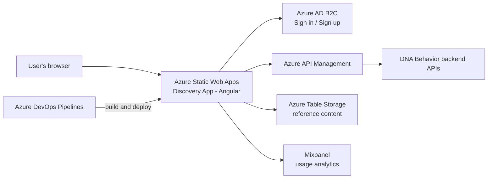

# DNA Behavior Discovery App – Documentation

12 October 2026

---

## 1. Project Overview

The Discovery App is a web application from DNA Behavior. An organization sends people a personal invitation link, and they use the app to complete their DNA behavioral assessment (the "Discovery"). There are two kinds of invitation link: Business DNA (talent) and Financial DNA (investor).

In the app, users open their invitation link, sign in or create an account, read the instructions and answer the Discovery questionnaire. When they finish, they see a dashboard with their behavioral style, insights and charts. They can also view Business DNA and Financial DNA reports, download them as PDF, and unsubscribe from completion emails.

Most data comes from the DNA Behavior backend APIs through Azure API Management. Some reference content, such as style video links and coaching text, is read directly from Azure Table Storage. The app is hosted on Azure Static Web Apps and is deployed by Azure DevOps pipelines.

The Angular app runs in the user's browser. It signs users in with Azure AD B2C, gets their data from the APIs and Table Storage, and sends usage events to Mixpanel.

---

## 2. Tech Stack and Packages

The app uses Angular 17.1 and TypeScript 5.3. The pipelines build it on Node.js 20.x.

| Package | Version | Purpose |
|---|---|---|
| @angular/core, common, router, forms, animations, cdk | ~17.1.3 | Application framework |
| @angular/cli, @angular-devkit/build-angular | ~17.1.3 | Build, local server and test runner |
| typescript | 5.3.3 | Programming language |
| @ngrx/store, @ngrx/effects, @ngrx/store-devtools | ^17.1.0 | Application state management |
| @azure/msal-angular, @azure/msal-browser | ^3.0.12, ^3.9.0 | Sign-in with Azure AD B2C |
| axios, rxjs | ^0.27.2, ~6.6.0 | Calls to the backend APIs |
| primeng, primeicons, primeflex | ^13.1.0, ^5.0.0, ^3.1.3 | Main UI component library |
| bootstrap, ngx-bootstrap, admin-lte | ^5.1.3, ^8.0.0, ^3.1.0 | Layout, styling and modals |
| chart.js, ng2-charts, chartjs plugins, ngx-gauge | ^4.4.1, ^5.0.4, –, ^4.0.0 | Charts and gauges on the dashboard and reports |
| jspdf | ^2.5.1 | PDF download of reports |
| mixpanel-browser | ^2.45.0 | Usage analytics |

Unit tests use Karma and Jasmine. Code quality is checked with ESLint (angular-eslint) and SonarQube (sonar-project.properties). The full list of packages is in package.json.

---

## 3. Environment Configuration

Each build configuration in angular.json replaces environment.ts with its own environment file at build time.

| Build configuration | Environment file | Source of values |
|---|---|---|
| dev | src/environments/environment.dev.ts | Values in the file (committed in the repository) |
| qa | src/environments/environment.qa.ts | Values in the file (committed in the repository) |
| sandbox | src/environments/environment.sandbox.ts | Values in the file (committed in the repository) |
| production | src/environments/environment.prod.ts | Values in the file (committed in the repository) |
| development (local `ng serve`) | src/environments/environment.ts | Values in the file (uses QA settings) |

There is no .env.example file. Every variable is listed in the environment files in src/environments.

| Variable | Description | Required |
|---|---|---|
| production | Marks a production build | Yes |
| base_url | Backend API address for signed-in calls (through API Management) | Yes |
| no_auth_url | Backend API address for calls that do not need sign-in | Yes |
| endpoint | API Management base address | Yes |
| hosting_url | Public address of the app | Yes |
| SignIn | Azure AD B2C sign-in user flow address | Yes |
| SignUp | Azure AD B2C sign-up user flow address | Yes |
| authorityDomain | Azure AD B2C login domain | Yes |
| client_id | Azure AD B2C application ID | Yes |
| scope | API permission requested at sign-in | Yes |
| mixpanelToken | Mixpanel project token | Yes |
| timeout | API request timeout (milliseconds) | Yes |
| azureTableUrl | Azure Table Storage address | Yes |
| azureSharedAccessKey | Shared Access Signature (SAS) token for Table Storage | Yes |

---

## 4. Azure Storage and Expiry

Azure Storage is Microsoft's cloud service for storing data. This project uses Azure **Table Storage**, a simple key-value store, to read reference content directly from the browser. It connects with a Shared Access Signature (SAS) token, which is a time-limited access key.

**The nearest expiry is 30 October 2026.** On that date the SAS token for saproddnabehavior expires. If it is not renewed, Sandbox and Production can no longer load style videos, factor relationships or coaching traits.

| Storage account | Environments |
|---|---|
| sauatenvironment | Dev, QA, local development |
| saproddnabehavior | Sandbox, Production |

| Tables/Containers | Purpose |
|---|---|
| BDNAUniqueStyleVideoLinks, FDNAUniqueStyleVideoLinks | Video links for each user's unique style (Business DNA and Financial DNA) |
| FactorRelationshipTable | Content describing how behavioral factors relate to each other |
| CoachingReportTraitsTableV1 | Trait text used in coaching content on the dashboard |

| Item | Type | Expiry date |
|---|---|---|
| saproddnabehavior access token (Sandbox, Production) | SAS token | 30 October 2026 |
| sauatenvironment access token (Dev, QA, local) | SAS token | 8 January 2027 |
| Static Web Apps deployment tokens (Dev, QA, Sandbox, Production) | Pipeline secret variable | To confirm |
| Custom domain SSL certificates (*.dnabehavior.com) | Certificate | To confirm |

---

## 5. Environments and Deployment

The development branch deploys to Dev and then QA. The main branch deploys to Sandbox and then Production.

| Environment | URL | Branch | Deployment trigger |
|---|---|---|---|
| Dev | https://devdiscovery.dnabehavior.com/ | development | Automatic on push (azure-pipelines.yml) |
| QA | https://qadiscovery.dnabehavior.com/ | development | Automatic after Dev deploys successfully; approval gate To confirm |
| Sandbox | https://sandboxdiscovery.dnabehavior.com/ | main | Automatic on push (discovery-app-pipelines-sandbox-production.yml) |
| Production | https://discovery.dnabehavior.com/ | main | Runs after the Sandbox stage; approval gate To confirm |

**Deployment steps**

1. A developer merges changes into the development branch (or into main for Sandbox and Production).
2. The push starts the matching Azure DevOps pipeline.
3. The pipeline installs Node.js 20.x and the project packages.
4. It builds the app with the matching configuration (dev, qa, sandbox or production).
5. It publishes the built files from dist/dna-behavior as a pipeline artifact.
6. The deployment stage uploads the artifact to the Azure Static Web App for that environment, using the environment's deployment token.
